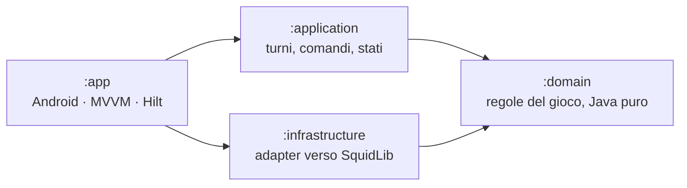

# SimpleRogueLike

[](https://github.com/MatteoCardarelli/SimpleRougeLike/actions/workflows/android-ci.yml)

Un roguelike a turni per Android, scritto in Java.

Il gioco è volutamente piccolo: un piano, qualche nemico, delle pozioni. Il progetto invece è un esercizio di ingegneria del software: architettura esplicita, regole verificate automaticamente, test e integrazione continua, come in un prodotto vero.

> **Stato: refactoring in corso.** Il codice attuale è la prima versione del gioco, in un solo modulo. La nuova architettura descritta qui sotto si costruisce un passo alla volta, e la vecchia sparisce solo quando la nuova fa tutto quello che faceva lei (vedi [Roadmap](#roadmap)).

## Il gioco

- **Mappa a griglia** di stanze e corridoi, generata a ogni partita.
- **A turni:** il tempo passa solo quando il giocatore agisce, e dopo ogni sua azione agiscono tutti i nemici.
- **Swipe** per muoversi; muoversi verso un nemico vuol dire attaccarlo.
- **Esperienza e livelli:** ogni nemico sconfitto dà esperienza, ogni livello aumenta salute e attacco.
- **Pozioni** da raccogliere sulla mappa e usare dall'inventario, che si apre con un doppio tap.
- **In arrivo con la v1:** nebbia di guerra che ricorda le zone esplorate, registro dei messaggi, schermata di fine partita, accessibilità di base.

## Architettura

Architettura esagonale (*ports and adapters*) divisa in quattro moduli Gradle. Le dipendenze vanno solo verso il centro, cioè verso le regole del gioco.



| Modulo | Cosa contiene |
|---|---|
| `:domain` | Le regole: mappa, personaggi, oggetti, combattimento, esperienza, intelligenza dei nemici. Java puro, senza Android e senza librerie esterne. Definisce le *porte*: le interfacce per generare il terreno, trovare un percorso e calcolare il campo visivo. |
| `:application` | Un turno dall'inizio alla fine: il comando del giocatore, le azioni dei nemici, lo stato della partita, cosa il giocatore può vedere. È l'unico punto d'ingresso per l'interfaccia. |
| `:infrastructure` | Gli *adapter*: implementano le porte del dominio usando SquidLib. Sostituire la libreria vuol dire scrivere un altro adapter, senza toccare le regole. |
| `:app` | L'app Android: trasforma i gesti in comandi, disegna la partita, riproduce gli eventi di ogni turno, gestisce l'inventario. |

**Le scelte principali**

- **Il gioco non conosce Android.** I tre moduli interni sono librerie Java: lì un `import android.*` non compila, e le regole si provano sulla JVM in pochi millisecondi.
- **Deterministico.** Stesso seed e stessi comandi danno la stessa partita, sul computer come sul telefono. Un bug si riproduce dal seed della partita in cui è comparso.
- **Ogni turno racconta cosa è successo.** Oltre allo stato finale, un turno restituisce la sequenza ordinata degli eventi (mosse, attacchi, danni, morti, oggetti raccolti). L'interfaccia li usa per i messaggi e, più avanti, per le animazioni.
- **Si aggiunge, non si modifica.** Un oggetto o un nemico nuovo è una riga di catalogo. Comportamenti dei nemici, effetti degli oggetti, comandi e regole di fine turno si aggiungono implementando un'interfaccia, senza cambiare le classi esistenti.

## Qualità

Obiettivo della v1, raggiunto durante il refactoring. Oggi la CI, su ogni push e pull request, controlla la formattazione, esegue Lint e i test unitari della prima versione e verifica i checksum delle dipendenze.

- **Regole d'architettura verificate dai test** con ArchUnit: dipendenze tra moduli e package, niente Android nel dominio, niente sorgenti casuali che rompano il determinismo.
- **Test sulla JVM** con JUnit 5 e AssertJ, senza mock nel dominio: i test giocano su mappe disegnate in ASCII.
- **Test di proprietà** con jqwik, su sequenze casuali di mosse: due personaggi non occupano mai la stessa cella, un morto resta morto, la stessa partita giocata due volte dà lo stesso risultato.
- **Test di contratto:** ogni adapter e ogni implementazione finta usata nei test passano gli stessi test.
- **Test golden:** una partita registrata deve produrre lo stesso risultato sulla JVM e su un dispositivo Android.
- **Copertura e mutation testing** con soglie minime (JaCoCo e PIT).
- **Stile e controlli statici** bloccanti: Spotless, Android Lint, NullAway, Animal Sniffer (nessuna API Java assente da Android 11 nei moduli Java).
- **GitHub Actions** su ogni push e pull request, con i test strumentati su un emulatore prima del merge nella branch principale.

## Roadmap

- [x] **0. Preparazione:** configurazione di build condivisa, dipendenze ripulite, formattazione automatica, CI su tutte le branch.
- [x] **1–2. `:domain`:** valori di base, mappa, personaggi, oggetti, regole, generazione, intelligenza dei nemici.
- [x] **3. `:infrastructure`:** adapter deterministici per terreno, percorsi e campo visivo.
- [ ] **4. `:application`:** turni completi, comandi, stati della partita.
- [ ] **5. Nuova app Android:** prima la stessa app di oggi sul nuovo motore, poi Hilt e MVVM, il nuovo rendering e le funzionalità nuove.
- [ ] **6. Pulizia:** rimozione del codice vecchio e release `v1.0.0`.

Dopo la v1: animazioni, poi nuovi contenuti.

## Compilare ed eseguire

Servono Android Studio, il JDK 21 e un dispositivo o un emulatore con Android 11 (API 30) o successivo. Si apre la cartella del progetto in Android Studio e si avvia la configurazione `app`, oppure da terminale:

```bash
./gradlew assembleDebug        # compila l'APK di debug
./gradlew testDebugUnitTest    # esegue i test unitari
./gradlew spotlessApply        # formatta il codice
```

Su Windows si usa `gradlew.bat` al posto di `./gradlew`.

## Tecnologie

Java 21 · Android SDK (minimo API 30) · AndroidX e Material Components · [SquidLib](https://github.com/yellowstonegames/SquidLib) per generazione delle mappe, percorsi e campo visivo · GitHub Actions. Con il refactoring: Hilt, JUnit 5, ArchUnit, jqwik, PIT, JaCoCo, Spotless, NullAway, Animal Sniffer.

## Autore

Matteo Cardarelli.

Il progetto non ha ancora una licenza: tutti i diritti sono riservati.
